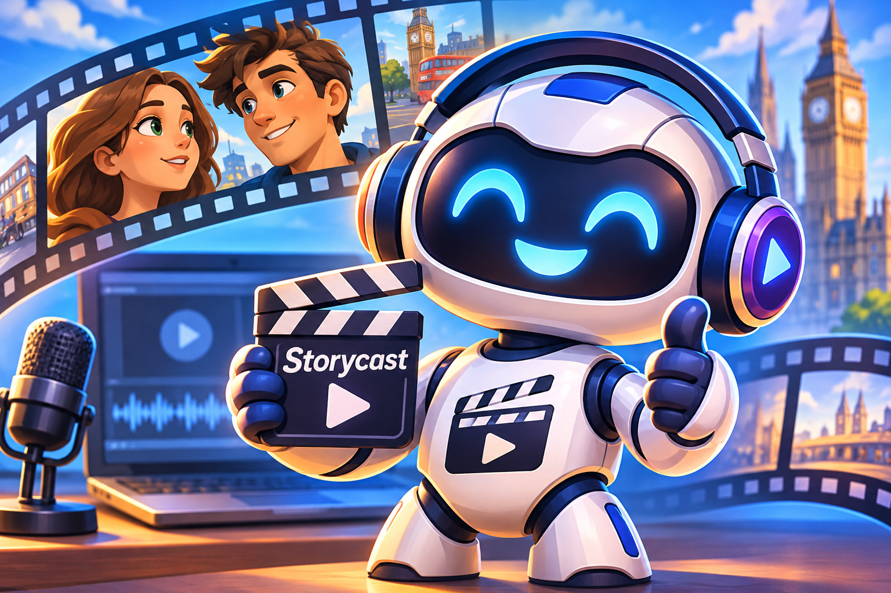

<h1 align="center">Storycast</h1>

<p align="center">
  
</p>

Storycast trasforma copioni strutturati in italiano in un **episodio audio/video e uno Short verticale con sottotitoli**. Associa le battute alle voci dei personaggi, sintetizza il parlato localmente con Qwen3-TTS e monta immagini e audio con FFmpeg. È pensato per produzioni ripetibili su CPU, con configurazioni esplicite, cache verificata e ripresa delle lavorazioni interrotte.

Il repository include il motore Python, gli script Bash, i Dockerfile, le configurazioni e una libreria di immagini. Modello AI e risultati generati restano esterni alla distribuzione Git. La preparazione richiede Internet; l'elaborazione successiva avviene offline nei container.

## Indice

- [Avvio rapido](#creare-una-storia-in-quattro-passi)
- [Architettura e servizi](#architettura-e-servizi-docker)
- [Controller e sequenza di elaborazione](#controller-e-sequenza-di-elaborazione)
- [Voci Qwen3-TTS](#generazione-delle-voci-con-qwen3-tts)
- [Audio e video con FFmpeg](#audio-e-video-con-ffmpeg)
- [Installazione](#installazione-da-zero)
- [Comandi](#varianti-utili)
- [Errori, revisione e ripresa](#errori-revisione-e-ripresa)
- [Test](#test)
- [Documentazione](#documentazione)

## Caratteristiche principali

- Dialoghi UTF-8 con speaker, emozioni, indicazioni sceniche e pause facoltative.
- Voci configurabili per personaggio: Vivian e Ryan nella configurazione fornita.
- Sintesi sequenziale su CPU, controlli tecnici sui WAV e revisione umana opzionale del principale.
- Regia deterministica con pose di parlato/ascolto, immagini di gruppo, crop, zoom e panoramiche leggere.
- Video principale orizzontale, variante accelerata e Short verticale da un copione dedicato.
- Stato persistente per storia, hash degli artefatti, cache audio e scene riutilizzabili.

Il montaggio usa immagini già disponibili. La generazione AI di nuove immagini non è integrata nella pipeline; lo script di animazione facciale in `scripts/` è una prova separata. Il controllo audio automatico non comprende un riconoscimento del parlato capace di certificare tutte le parole.


*Pipeline universale `genera`: l’orchestratore Python coordina TTS, regia e FFmpeg nel servizio `storycast-tts`. Il servizio `storycast-renderer` offre i comandi visivi dedicati. Vivian e Ryan sono le voci associate agli ID dei personaggi.*

## Creare una storia in quattro passi

1. Scrivi il dialogo principale e il relativo Short nel formato Storycast.
2. Salvali come `input/nome_storia.txt` e `input/nome_storia-short.txt`.
3. Esegui:

   ```bash
   ./avvia-storycast.sh genera input/nome_storia.txt
   ```

4. Trova il risultato in:

   ```text
   output/nome_storia/nome_storia_audio.wav
   output/nome_storia/nome_storia_video.mp4
   output/nome_storia/nome_storia_video_speed115.mp4
   output/nome_storia/nome_storia_short_audio.wav
   output/nome_storia/nome_storia_short_video.mp4
   output/nome_storia/nome_storia_short_subtitles.srt
   ```

Entrambi i file sono obbligatori prima della pipeline universale e devono includere almeno una battuta per ciascun personaggio elencato in `config/pipeline.json` (attualmente `personaggio_1` e `personaggio_2`). Il comando valida il bundle, associa le voci, genera sequenzialmente i WAV con Qwen3-TTS, esegue il controllo tecnico, unisce l'audio, crea timeline e regia visiva, renderizza e verifica video principale e Short. La generazione avviene offline in Docker, senza installare dipendenze applicative sull'host.

Il codice Python locale è montato read-only in tutti i servizi Docker: dopo una modifica al motore non serve ricostruire le immagini. Il rebuild è necessario soltanto se cambiano Dockerfile o dipendenze di base.

La libreria visiva reale viene scoperta ricorsivamente in `assets/characters/<id>/` e `assets/groups/`. I riferimenti `immagine_principale` nelle schede personaggio sono opzionali e non alimentano il montaggio; le sottocartelle `approved` e `archive` sono escluse dal catalogo. Per verificare esattamente directory, permessi e conteggi visti dal container usare `./avvia-storycast.sh visual-library-check`.

Gli esempi minimi realmente pubblicati sono `input/MODELLO_DIALOGO.txt` e `input/MODELLO_DIALOGO-short.txt`.

## Architettura e servizi Docker

I servizi definiti in [docker-compose.yml](docker-compose.yml) sono processi batch avviati con `docker compose run --rm`: eseguono un comando e terminano. Non serve avviare un insieme di server permanenti con `docker compose up`.

| Servizio | Responsabilità effettiva | Limiti Compose |
| --- | --- | --- |
| `storycast-controller` | Parser, validazione, timeline preliminare, controlli e test tramite `storycast.cli`; usa la libreria standard Python. | 1 CPU, 256 MiB |
| `storycast-tts` | Qwen3-TTS e comandi audio; ospita `storycast.orchestrator`, che con `genera` esegue l'intero pacchetto, compresi FFmpeg e Short. | 2 CPU, 8 GiB |
| `storycast-renderer` | Comandi visivi dedicati, catalogo immagini, rendering e diagnostica; include FFmpeg e Pillow. | 2 CPU, 2 GiB |
| `storycast-cleanup` | Inventario e cancellazione controllata delle aree runtime; riusa l'immagine controller. | Nessun limite esplicito nel Compose |

Il container TTS include anch'esso FFmpeg e Pillow: il comando generale non avvia un container renderer per ogni fase. I comandi storici e diagnostici vengono invece indirizzati ai servizi dedicati dallo script Bash. Le fasi di una generazione sono sequenziali.

Tutti i servizi hanno rete disabilitata. Codice, configurazioni, input e asset sono montati in sola lettura; `work/`, `output/` e `logs/` sono le aree persistenti scrivibili del progetto. Il modello è montato in sola lettura nel TTS. I processi usano UID/GID configurabili tramite `STORYCAST_UID` e `STORYCAST_GID` (default `1000:1000`): tali utenti devono poter scrivere nelle directory runtime.

### Struttura del repository

| Percorso | Contenuto |
| --- | --- |
| `storycast/` | Parser, orchestratore, TTS, QC, pipeline Short, regia, rendering e gestione lavori. |
| `config/` | Personaggi, voci, parametri TTS, requisiti del bundle e impostazioni visive. |
| `assets/characters/`, `assets/groups/` | Immagini sorgente dei personaggi e delle composizioni di gruppo. |
| `assets/story_images/` | Directory facoltativa per inserti narrativi del principale. |
| `input/` | Copioni principali e relativi `-short.txt`; sono pubblicati due modelli neutri. |
| `models/` | Posizione predefinita del modello locale, escluso da Git. |
| `work/episodes/<slug>/` | Stato, sorgenti copiate, segmenti, metadati e scene della storia; Short sotto `short/`. |
| `output/<slug>/` | WAV, MP4, sottotitoli, manifest, timeline, piano visivo e report. |
| `logs/` | Log persistenti e collegamento `latest.log`. |
| `docker/`, `Dockerfile*` | Immagini base, dipendenze e immagini applicative. |
| `scripts/`, `tests/`, `docs/` | Strumenti accessori, test automatici e approfondimenti. |

Il parser scopre gli ID da `config/characters/*.yaml`; il numero di personaggi non è fissato nel codice. L'aggiunta di uno speaker richiede configurazione del personaggio, voce e immagini coerenti, oltre al crop verticale in `config/pipeline.json` per lo Short; i personaggi obbligatori del bundle sono definiti separatamente in `config/pipeline.json`.

## Controller e sequenza di elaborazione

`avvia-storycast.sh` è l'interfaccia consigliata: seleziona il servizio Docker e inoltra comando e opzioni. Il controller leggero gestisce parsing e controlli di base; il coordinamento completo appartiene a [storycast/orchestrator.py](storycast/orchestrator.py).

1. **Precheck del bundle:** individua il file Short gemello e valida entrambi i copioni, gli speaker e i personaggi obbligatori. `precheck` verifica questi input; `piano` aggiunge informazioni su voci, cache, libreria e fasi previste senza inferenza.
2. **Preparazione del principale:** determina lo slug, acquisisce il lock, confronta input e stato e verifica voci, modello, libreria visiva, spazio libero e scrivibilità. Il controllo operativo richiede almeno 1 GiB libero, che è una soglia minima e non una stima dello spazio totale necessario.
3. **Piano e sintesi TTS:** associa voce, istruzione, seed e segmentazione a ciascuna battuta; riusa soltanto i WAV con cache valida.
4. **QC e revisione:** controlla i segmenti e, con `--review-audio`, attende l'approvazione dei WAV del principale prima del montaggio.
5. **Audio e timeline:** unisce i segmenti con le pause e calcola gli istanti di inizio/fine dalle durate WAV effettive.
6. **Regia e video principale:** seleziona pose e inquadrature, prepara le immagini derivate, renderizza le scene, concatena e abbina l'audio. Verifica il risultato e produce la variante accelerata, se abilitata.
7. **Short:** elabora il copione `-short.txt` nel proprio namespace, genera audio, scene verticali e sottotitoli, applica velocità e fermo immagine finale.
8. **Controlli del pacchetto:** verifica gli output richiesti e aggiorna stato e report. Un errore dello Short conserva il principale già completato e lascia il pacchetto riprendibile.

Lo **slug** identifica una lavorazione e le sue cartelle. Deriva dal nome del file normalizzato oppure da `--nome`; un nome esplicito deve iniziare con una lettera minuscola o un numero e contenere soltanto lettere minuscole, numeri, `_` e `-`.

## Generazione delle voci con Qwen3-TTS

Il backend reale carica `Qwen/Qwen3-TTS-12Hz-1.7B-CustomVoice` da disco, su CPU e in `float32`. La configurazione effettiva è in [config/tts.json](config/tts.json) e [config/voices.yaml](config/voices.yaml). Le voci iniziali sono Vivian per `personaggio_1` e Ryan per `personaggio_2`; non si tratta di clonazione delle voci da registrazioni utente.

Il modello riceve separatamente testo (`text`), lingua parlata (`language=Italian`), voce (`speaker`) e stile (`instruct`). Per le nuove storie il profilo predefinito `english_default` esprime tono e ritmo in inglese mantenendo il parlato italiano; `italian_legacy` resta disponibile. Le emozioni riconosciute usano il mapping configurato; quelle sconosciute ricadono sull'indicazione neutra.

Le battute lunghe vengono suddivise privilegiando la punteggiatura. I sotto-segmenti sono sintetizzati uno alla volta, con seed e parametri espliciti, e ricomposti in WAV **PCM16 mono a 24 kHz**. Il modello è caricato al primo segmento da generare e riusato nel ciclo di generazione.

Il profilo CPU prudente attende **30 secondi dopo ogni inferenza reale**; in caso di errore attende altri **60 secondi prima dell'unico retry** con seed alternativo. Cache hit, dry-run e backend mock non applicano queste attese. Tempi complessivi e qualità dipendono dal testo e dall'hardware; la sintesi 1.7B su CPU può essere molto lenta.

Ogni WAV viene prima scritto come `.partial`, sincronizzato e controllato dal QC v4. Hash, formato, durata, silenzi, livello audio e possibili troncamenti determinano la validità tecnica. File incompleti, sospetti o incoerenti non entrano nella cache o nel merge. La cache considera testo, voce, istruzioni, seed, parametri e identità del modello/backend: audio mock e reale restano distinti. Il mock produce segnali sintetici per i test, senza parlato Qwen.

Per dettagli: [TTS](docs/TTS.md), [voci](docs/VOCI.md), [istruzioni vocali](docs/ISTRUZIONI_VOCALI.md), [pause CPU](docs/PAUSE_CPU.md) e [segmenti troncati](docs/SEGMENTI_TTS_TRONCATI.md).

## Audio e video con FFmpeg

Il merge dei WAV e la timeline sono gestiti dal Python; FFmpeg si occupa di scene, concatenazione, codifica e montaggio audiovisivo. Il planner sceglie immagini già presenti in base a speaker, pose e durate; applica crop e movimenti leggeri senza modificare gli originali. Derivate e scene intermedie hanno firme di cache.

| Risultato | Impostazioni predefinite |
| --- | --- |
| Audio principale e Short | WAV PCM16, mono, 24 kHz, alla velocità naturale. |
| Video principale | MP4, 1280 × 720, 30 fps, H.264/yuv420p, AAC mono 24 kHz, faststart. |
| Variante principale | Video e audio a 1,15×, in un MP4 separato; il video normale resta disponibile. |
| Video Short | MP4, 1080 × 1920 (9:16), 30 fps, H.264/AAC, sottotitoli impressi, velocità 1,30× e 2 secondi finali di ultimo fotogramma con silenzio. |
| Sottotitoli Short | File SRT con tempi adattati alla velocità finale; sono derivati dal copione e dalla timeline, senza allineamento ASR parola per parola. |

Le impostazioni sono in [config/render.yaml](config/render.yaml) e [config/pipeline.json](config/pipeline.json). I controlli con FFprobe e l'estrazione di fotogrammi verificano caratteristiche del video e sincronizzazione tecnica; la qualità percepita richiede visione e ascolto.

## Installazione da zero

Servono Bash, Git per clonare il repository, Docker Engine avviato e accessibile senza `sudo`, Compose v2, spazio per immagini/modello/cache/video e almeno 8 GiB di RAM disponibili al TTS, oltre alla memoria per sistema operativo e Docker. La configurazione CPU è pensata per AVX senza richiedere AVX2; non richiede GPU. Il repository contiene codice, Dockerfile e asset; non contiene immagini Docker binarie, modello AI, input reali o output.

```bash
git clone https://github.com/Uraroga/storycast-docker
cd storycast-docker
./download-model.sh
./build-storycast.sh
./avvia-storycast.sh precheck input/MODELLO_DIALOGO.txt --nome esempio
./avvia-storycast.sh piano --input input/MODELLO_DIALOGO.txt --nome esempio --dry-run
```

Per generare anche i media di esempio dopo i controlli:

```bash
./avvia-storycast.sh genera input/MODELLO_DIALOGO.txt --nome esempio --story-images no
```

`download-model.sh` è l'azione esplicita che scarica il modello ufficiale (circa 4,2 GiB); `build-storycast.sh` non lo scarica. In alternativa:

```bash
export STORYCAST_MODELS_HOST=/percorso/alla/directory-che-contiene-il-modello
./build-storycast.sh
```

La directory indicata deve contenere `Qwen3-TTS-12Hz-1.7B-CustomVoice/`. Struttura e verifica sono in [MODELLI.md](docs/MODELLI.md). Se il modello manca, la build delle immagini termina ma lo script restituisce codice `2` segnalando i file mancanti. La build è idempotente; `STORYCAST_FORCE_BASE_BUILD=1 ./build-storycast.sh` forza la ricostruzione delle basi.

La preparazione può richiedere Internet per immagini pubbliche, pacchetti e modello. L'esecuzione è offline: i servizi usano `network_mode: none`, `HF_HUB_OFFLINE=1` e `TRANSFORMERS_OFFLINE=1`.

Formato minimo del dialogo:

```text
[personaggio_1|curiosa]
Oggi vorrei raccontare una storia particolare.

[personaggio_2|riflessivo]
Allora cominciamo dall'inizio.
```

Solo lo speaker è obbligatorio nell'intestazione. Sono ammessi, per esempio, `[personaggio_1|curiosa|scena=sorride|pausa=0.4]`, con `stage` e `pause` come alias. Il testo continua fino all'intestazione successiva; non inserire traduzioni delle istruzioni vocali nel parlato. Consultare il [formato completo](docs/FORMATO_DIALOGO.md).

## Varianti utili

I comandi vanno eseguiti dalla radice del repository. `genera` senza input usa `input/dialogo.txt` e richiede anche `input/dialogo-short.txt`: questi file non sono inclusi nel clone. Usare i modelli pubblicati oppure creare la coppia desiderata.


```bash
./avvia-storycast.sh genera
./avvia-storycast.sh genera input/nuova_storia.txt --nome nuova_storia
./avvia-storycast.sh piano --input input/nuova_storia.txt --nome nuova_storia --dry-run
./avvia-storycast.sh genera input/nuova_storia.txt --review-audio
./avvia-storycast.sh stato --nome nuova_storia
./avvia-storycast.sh segmenti --nome nuova_storia
./avvia-storycast.sh ascolta --nome nuova_storia --indice 1
./avvia-storycast.sh approva --nome nuova_storia --indice 1
./avvia-storycast.sh riprendi --nome nuova_storia
./avvia-storycast.sh verifica --nome nuova_storia
./avvia-storycast.sh pulisci --nome nuova_storia --dry-run
./avvia-storycast.sh elimina-storia --nome nuova_storia --dry-run
./avvia-storycast.sh spazio-lavori
./avvia-storycast.sh work-status
./avvia-storycast.sh work-status --details
./avvia-storycast.sh clean-work --dry-run
./avvia-storycast.sh clean-work --yes
```

## Versione finale accelerata

Al termine del montaggio Storycast conserva il video normale e produce, per impostazione predefinita, anche la variante principale a `1.15x`. Audio e video vengono accelerati insieme con `atempo` e `setpts`, mantenendo sostanzialmente invariata la tonalità. Da `storia_video.mp4` deriva quindi `storia_video_speed115.mp4`. Lo Short conserva indipendentemente velocità `1.30x` e hold finale di 2 secondi.

```bash
./avvia-storycast.sh genera input/storia.txt --nome storia
./avvia-storycast.sh genera input/storia.txt --nome storia --velocita 1.20
./avvia-storycast.sh genera input/storia.txt --nome storia --no-speed-version
```

Le opzioni CLI hanno precedenza sulla sezione `final_speed_version` di `config/render.yaml`, che permette di disabilitare la variante e configurare fattore, suffisso, preset, CRF e bitrate AAC. `--sostituisci` autorizza anche la sostituzione controllata di una variante accelerata preesistente; altrimenti una variante già valida viene riutilizzata. Un errore nel post-processing non elimina né sovrascrive mai il video normale.

Ogni storia usa `work/episodes/<slug>/` e `output/<slug>/`. Un rilancio con lo stesso input recupera WAV, crop, scene e output validi. Se lo stesso slug viene associato a contenuto diverso il comando si ferma; usare un nuovo `--nome` oppure l'opzione intenzionale `--sostituisci`, che crea prima un backup degli output esistenti.

## Immagini opzionali della storia

Le immagini `.png`, `.jpg`, `.jpeg` e `.webp` collocate direttamente in
`assets/story_images/` possono essere usate come inserti nel solo video
principale. `genera` chiede conferma in un terminale interattivo; automazioni e
test usano `--story-images yes` oppure `--story-images no`. In modalità `ask`
non interattiva Storycast continua senza immagini e non resta bloccato.

Gli inserti durano 6 secondi, hanno fade di 0,4 secondi e zoom lento. Sono
distribuiti deterministicamente tra 20 secondi dall'inizio e 30 secondi dalla
fine, con densità massima indicativa di uno ogni 60 secondi. La variante 1,15x
viene prodotta dopo il montaggio naturale. Contenuto e configurazione delle
immagini partecipano alla firma cache del principale; lo Short non le legge.

## Errori, revisione e ripresa

In caso di interruzione, conservare `work/` e rilanciare lo stesso comando, con gli stessi input e opzioni:

```bash
./avvia-storycast.sh genera input/nome_storia.txt --nome nome_storia
./avvia-storycast.sh stato --nome nome_storia
./avvia-storycast.sh verifica --nome nome_storia
```

Lo stato è in `work/episodes/<slug>/state.json`, scritto atomicamente. Il lock per slug blocca una lavorazione già attiva; i lock riconosciuti come obsoleti vengono conservati per diagnosi. La ripresa riusa artefatti integri e coerenti e ricostruisce quelli mancanti o invalidi. Un file `.partial` non viene accettato come risultato completo.

| Situazione | Azione |
| --- | --- |
| Short assente, input non UTF-8 o speaker errato | Correggere i copioni e ripetere `precheck` prima della generazione. |
| Modello o immagine Docker mancante | Completare download/configurazione modello e build; non sono scaricati durante `genera`. |
| Lunga attesa dopo il TTS | Consultare `cpu-cooldown-status --nome nome_storia` e lo stato prima di interrompere: il cooldown è previsto. |
| Segmento sospetto o troncato | Diagnosticare e ascoltare il segmento; effettuare una riparazione mirata. |
| `awaiting_review` | Ascoltare e approvare tutti i segmenti richiesti del principale, poi eseguire `riprendi`. |
| Short fallito dopo il principale | Correggere la causa e rieseguire `genera`; il principale valido viene conservato. |
| Stesso slug con input principale diverso | Scegliere un nuovo `--nome` oppure usare intenzionalmente `--sostituisci`, che salva prima un backup degli artefatti principali previsti. |
| Spazio insufficiente o directory non scrivibile | Verificare spazio, UID/GID e permessi delle aree runtime. |

Esempio di diagnosi e riparazione di un segmento del principale (sostituire `1` con l'indice segnalato):

```bash
./avvia-storycast.sh verifica-segmenti --nome nome_storia
./avvia-storycast.sh segmenti-sospetti --nome nome_storia
./avvia-storycast.sh diagnostica-segmento --nome nome_storia --indice 1
./avvia-storycast.sh ascolta --nome nome_storia --indice 1
./avvia-storycast.sh ripara-segmento --nome nome_storia --indice 1 --dry-run
./avvia-storycast.sh ripara-segmento --nome nome_storia --indice 1 --yes
./avvia-storycast.sh ascolta --nome nome_storia --indice 1
./avvia-storycast.sh approva --nome nome_storia --indice 1
./avvia-storycast.sh riprendi --nome nome_storia
```

`ripara-segmento` tenta prima il recupero di un WAV scartato che superi i controlli; altrimenti rigenera con seed alternativo e segmentazione prudente. `ripara-sospetti --dry-run` è un'anteprima, non una riparazione multipla automatica. Per forzare una nuova inferenza sul singolo indice usare `rigenera --nome nome_storia --indice 1 --alternate-seed --prudent`, dopo averne valutato il piano con `--dry-run`.

La revisione opzionale si attiva con `genera INPUT --review-audio`: l'approvazione è legata all'hash del WAV e va ripetuta se cambia. I comandi `segmenti`, `ascolta`, `approva` e la riparazione sopra riguardano il principale; lo Short ha i propri comandi `short-list-segments`, `short-ascolta` e `short-video-play`. La riproduzione usa `ffplay` se presente sull'host, altrimenti stampa il percorso del file: non è una dipendenza necessaria alla generazione.

Approfondimenti: [ripresa dopo interruzione](docs/RIPRESA_DOPO_INTERRUZIONE.md) e [modalità revisione](docs/MODALITA_REVISIONE.md).

## Cartella work e pulizia

`work/` è lo spazio di lavorazione riprendibile: durante una generazione viene nuovamente popolato con stato, copie sorgente, WAV e metadata dei segmenti, timeline, cache visiva e scene intermedie. I WAV e i metadata sono necessari anche a `segmenti`, `ascolta`, rigenerazione selettiva e ripresa dopo un'interruzione; le scene e le derivate evitano rendering già validi.

`work-status` mostra un riepilogo senza modificare file; `--details` aggiunge una sola riga per episodio e una ripartizione per tipo. `clean-work` elimina intenzionalmente tutte le lavorazioni presenti in `work/`, incluse cache TTS locali, dati di ripresa e dati necessari ai comandi segmento. Non elimina la cache/modelli esterni montati in `/models`, né `assets/`, `config/`, `output/`, `logs/` o eventuale `cache/` esterna a `work/`.

Per sicurezza la pulizia richiede sempre prima un dry-run e poi conferma esplicita:

```bash
./avvia-storycast.sh clean-work --dry-run
./avvia-storycast.sh clean-work --yes
```

La normale generazione popolerà nuovamente `work/`. Usare `clean-work --yes` soltanto quando si vuole davvero rinunciare alla ripresa delle lavorazioni e alla rigenerazione basata sui segmenti presenti.

## Log sintetici

Ogni esecuzione non-dry-run di `genera` crea un log persistente in `logs/<episodio>_AAAAMMGG_HHMMSS.log`; collisioni nello stesso secondo ricevono un suffisso numerico e non sovrascrivono mai un file precedente. `logs/latest.log` è un collegamento relativo all'esecuzione più recente e resta valido sia dall'host sia dal container.

Il log contiene soltanto avvio, input, conteggi di dialogo/personaggi/immagini, riepilogo TTS e cache, audio, timeline visiva, una riga di avanzamento per scena, montaggio, durate, warning significativi ed esito o errore di fase. Non contiene testo delle battute, progressi per frame o comandi FFmpeg completi.

```bash
./avvia-storycast.sh logs
./avvia-storycast.sh log-last
tail -f logs/latest.log
```

Sono conservati automaticamente gli ultimi 20 file riconosciuti come log Storycast; file manuali o con altri nomi non vengono rimossi. Il valore può essere cambiato con `STORYCAST_LOG_KEEP`. Il livello normale è `INFO`; `STORYCAST_LOG_LEVEL=WARNING`, `ERROR` o `DEBUG` modifica la soglia. `DEBUG` è previsto per diagnosi future ma la pipeline normale non emette dettagli verbosi. Il fuso predefinito è `Europe/Rome`, configurabile con `STORYCAST_TIMEZONE`.

La revisione umana non viene simulata: il QC automatico verifica soltanto caratteristiche tecniche, non la fedeltà semantica del parlato.

Dopo aver copiato il risultato fuori dal progetto, gli artefatti generati di una storia possono essere rimossi senza backup con `elimina-storia --nome SLUG --dry-run`, seguito da `--yes`. Gli input principali e Short restano sempre preservati. `azzera-lavori --dry-run` inventaria tutti i dati nelle sole aree runtime autorizzate `output/`, `work/` e `logs/`; `azzera-lavori --yes` li elimina integralmente. Vedere [Cancellazione storia](docs/CANCELLAZIONE_STORIA.md).

Per le nuove storie il profilo predefinito è `english_default`: testo e lingua dichiarata restano italiani, mentre tono e ritmo sono formulati in inglese. Il profilo `italian_legacy` resta disponibile. Vedere [Istruzioni vocali](docs/ISTRUZIONI_VOCALI.md).

## Requisiti e build manuale

- Docker con Compose;
- almeno 8 GB di RAM disponibili al servizio TTS;
- modello Qwen3-TTS locale montato read-only come descritto in [MODELLI.md](docs/MODELLI.md);
- nessuna rete richiesta durante l'utilizzo, dopo la preparazione.

Il percorso raccomandato è `./build-storycast.sh`. Per una build manuale completa, l'ordine è:

```bash
docker build -f docker/base-tts/Dockerfile -t qwen3-tts-cpu:local .
docker build -f docker/base-renderer/Dockerfile -t voiceover-to-video:local .
docker compose build storycast-controller storycast-tts storycast-renderer
```

Se le immagini base e tutte le dipendenze sono già nella cache Docker, la build può essere forzata offline:

```bash
docker build --network none -t storycast-controller:local .
docker build --network none -f Dockerfile.tts -t storycast-tts:local .
docker build --network none -f Dockerfile.renderer -t storycast-renderer:local .
```

Per verificare configurazione, input e fasi previste senza avviare inferenza o rendering:

```bash
./avvia-storycast.sh piano --input input/MODELLO_DIALOGO.txt --nome esempio --dry-run
```

## Test

I test che non richiedono FFmpeg possono essere eseguiti nel controller, senza installare librerie sull'host:

```bash
docker compose build storycast-controller
docker compose run --rm --entrypoint sh storycast-controller -c \
  'for test in test_audio_qc.py test_cleanup.py test_episode_bundle.py test_instruction_profiles.py test_run_logging.py test_short_pipeline.py test_storycast.py test_tts_safety.py test_work_manager.py; do python -m unittest discover -s tests -p "$test" || exit 1; done'
```

La suite completa, inclusi i test che richiedono FFmpeg, va eseguita nell'immagine renderer:

```bash
docker compose build storycast-renderer
docker compose run --rm --entrypoint python storycast-renderer -m unittest discover -s tests -v
```

Il modello Qwen non è distribuito con Storycast e i test di inferenza reale sono separati perché l'esecuzione CPU può essere molto lenta. Il progetto è calibrato per CPU AVX senza AVX2; qualità e tempi dipendono da modello, testo e hardware.

## Licenza

Il codice è distribuito secondo la [licenza MIT](LICENSE). Il modello Qwen3-TTS non è incluso e mantiene la propria licenza; consultare [MODELLI.md](docs/MODELLI.md).

## Documentazione

Il [manuale d'uso](MANUALE_USO.md) raccoglie comandi, parametri e procedure dettagliate. Le guide in `docs/` approfondiscono i singoli componenti:

| Argomento | Documenti |
| --- | --- |
| Avvio e preparazione copioni | [Uso semplice](docs/USO_SEMPLICE.md), [nuova storia](docs/NUOVA_STORIA.md), [formato dialogo](docs/FORMATO_DIALOGO.md). |
| Architettura e ambiente | [Architettura](docs/ARCHITETTURA.md), [build riproducibile](docs/BUILD_RIPRODUCIBILE.md), [modelli](docs/MODELLI.md). |
| Sintesi e qualità audio | [TTS](docs/TTS.md), [voci](docs/VOCI.md), [istruzioni vocali](docs/ISTRUZIONI_VOCALI.md), [cache audio](docs/CACHE_AUDIO.md), [pause CPU](docs/PAUSE_CPU.md), [segmenti troncati](docs/SEGMENTI_TTS_TRONCATI.md). |
| Immagini e rendering | [Asset visivi](docs/ASSET_VISIVI.md), [libreria dinamica](docs/LIBRERIA_VISIVA.md), [motore visivo](docs/MOTORE_VISIVO.md), [rendering](docs/RENDERING.md). |
| Gestione delle lavorazioni | [Ripresa](docs/RIPRESA_DOPO_INTERRUZIONE.md), [revisione audio](docs/MODALITA_REVISIONE.md), [cancellazione e reset](docs/CANCELLAZIONE_STORIA.md). |
| Prove e sviluppo | [Test TTS reale](docs/TEST_TTS_REALE.md), [test video reale](docs/TEST_VIDEO_REALE.md), [roadmap](docs/ROADMAP.md). |

### Presentazioni e diagrammi

- [Storycast: architettura e flusso operativo (PowerPoint)](docs/Storycast_20261117.pptx): panoramica del sistema, orchestrazione, TTS, cache e comandi di recupero.
- [Storycast: guida completa (PowerPoint)](docs/Storycast_Guida_Completa.pptx): introduzione ai copioni, personaggi, emozioni, immagini e utilizzo.
- [Schema dal copione all'audio e al video](docs/02_Flusso%20Storycast_%20copione,%20audio%20e%20video.png) e [diagramma del flusso Docker](docs/03_Diagramma%20del%20flusso%20Storycast%20in%20Docker.png): schemi concettuali alternativi all'infografica incorporata sopra.

Tutti e tre i diagrammi distinguono i due copioni obbligatori per `genera`, l’orchestratore Python e il ruolo dei servizi Docker. La libreria personaggi/gruppi è necessaria; solo gli inserti in `assets/story_images/` sono facoltativi. Le guide dei test e la roadmap includono riferimenti storici a input e risultati locali non distribuiti: per un clone nuovo partire dai due `MODELLO_DIALOGO` e dalle istruzioni di questo README. La documentazione pubblica qui collegata comprende guide Markdown e presentazioni PowerPoint; non include versioni Word o PDF.

I comandi storici dell'episodio 01, del TTS e del renderer restano disponibili per compatibilità e diagnosi; `./avvia-storycast.sh help` ne mostra l'elenco.
